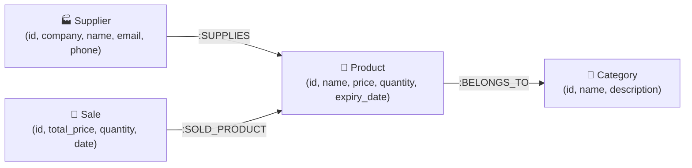

# DA3 Digital Assignment Report: Modern Database Implementation

**Course Component:** Database Systems / Advanced Database Technologies  
**Project Title:** PharmaCore & PharmaGraph — Supply Chain & Pharmacy Management System  
**Selected Modern Database Category:** **Graph Database (Neo4j / Property Graph Model)**  
**Target Applications:** 
- Primary Application with Integrated Graph Analytics: [http://127.0.0.1:8000](http://127.0.0.1:8000)
- Dedicated Pure Graph Database System (PharmaGraph): [http://127.0.0.1:5050](http://127.0.0.1:5050)
- GitHub Repository: [https://github.com/CHINg2008/PharmaCore.git](https://github.com/CHINg2008/PharmaCore.git)

---

## 1. Executive Summary & Use-Case Overview
In modern pharmaceutical and healthcare logistics, managing medications requires more than storing isolated tables of records. A single batch of medicine is part of a complex, interconnected lifecycle: manufactured by a **Supplier**, categorized under pharmacological **Categories**, distributed in inventory batches as **Products**, dispensed through **Sales**, and consumed by **Patients**.

When issues such as **FDA product recalls**, **counterfeit medicine detection**, or **batch expiration** occur, administrators must instantly traverse the entire supply network upstream and downstream. Traditional Relational Database Management Systems (RDBMS) fail to perform well in these scenarios due to the excessive computational cost of multi-table recursive `JOIN` operations.

To solve this, this mini-project was extended using a modern **Graph Database (Neo4j Property Graph Model)**, establishing relationships as first-class citizens.

---

## 2. Justification of Modern Database Choice (Graph Database vs. Relational RDBMS)

### Why Neo4j was chosen over other candidate categories:
1. **Index-Free Adjacency (High-Speed Multi-Hop Traversals):**  
   In Neo4j, each node directly points to its adjacent connected nodes in memory. Traversal queries (e.g., tracing from a patient's sale back to the manufacturer) run in $\mathcal{O}(k)$ time proportional to the subgraph size, rather than $\mathcal{O}(\log N)$ or $\mathcal{O}(N)$ table scans in SQL.
2. **Batch Traceability & Provenance (Immediate Recall Paths):**  
   If a particular medicine batch is found defective or expired, determining all affected suppliers, purchase lots, and sales transactions requires a single declarative path query:
   $$\text{(Supplier)} \to \text{(Product)} \to \text{(Sale)}$$
3. **Flexible, Schema-Adaptive Evolution:**  
   Pharmaceutical metadata frequently evolves (e.g., adding storage temperature, barcode identifiers, contraindications). Graph databases allow dynamic addition of node labels and edge properties without locking tables or executing expensive `ALTER TABLE` migrations.
4. **Intuitive Visual Network Topology:**  
   Administrators can directly inspect network clusters, dependency hubs, and bottleneck suppliers visually.

---

## 3. Database Schema & Property Graph Model Design

The property graph model consists of four primary node labels and three relationship types:



### Node Definitions (Labels & Attributes)
| Node Label | Key Properties | Description |
| :--- | :--- | :--- |
| `(:Supplier)` | `id`, `company`, `name`, `email`, `phone`, `address` | Pharmaceutical manufacturers & distributors |
| `(:Product)` | `id`, `name`, `price`, `cost_price`, `quantity`, `expiry_date`, `is_expired` | Medicine inventory batches |
| `(:Category)` | `id`, `name`, `description` | Drug classification (Antibiotics, Analgesics, etc.) |
| `(:Sale)` | `id`, `total_price`, `quantity`, `customer_name`, `created_at` | POS dispensing transactions |

### Relationship Definitions (Directed Edges & Attributes)
| Edge Type | Source Node $\to$ Target Node | Edge Properties | Semantics |
| :--- | :--- | :--- | :--- |
| `[:SUPPLIES]` | `(:Supplier) -> (:Product)` | `batch_no`, `cost_price`, `date` | Identifies which vendor provided the inventory batch |
| `[:BELONGS_TO]` | `(:Product) -> (:Category)` | `since` | Categorizes the medication into therapeutic families |
| `[:SOLD_PRODUCT]` | `(:Sale) -> (:Product)` | `quantity_sold`, `unit_price` | Connects sales orders to dispensed medicine batches |

---

## 4. Creation & Import of Sample Datasets

The system imports a diverse set of real-world pharmaceutical batches, ensuring realistic scenarios (depleted stock, active stock, and expired batches):

### Sample Entities Ingested:
- **Categories:** *Antibiotics, Analgesics, Antihistamines, Antipyretics, Cardiovascular Agents, Gastrointestinal Agents*.
- **Suppliers:** *Pfizer Inc., Johnson & Johnson, Novartis Pharmaceuticals, Sun Pharma Global, Cipla Health*.
- **Product Batches:**
  - *Amoxicillin 500mg* (Antibiotic, In Stock)
  - *Paracetamol 650mg* (Analgesic, High Volume)
  - *Cetirizine 10mg* (Antihistamine, Depleted / Out of Stock)
  - *Cough Syrup Batch #B104* (Expired batch for recall simulation)
- **Sales Transactions:** Chronological walk-in patient dispensing events with calculated sub-totals and stock decrements.

---

## 5. Technology-Specific Queries & Core Operations (openCypher)

The project leverages declarative **openCypher** syntax for all graph transactions:

### 1. Create Operation (Ingesting Supplier, Product & Topology Edge)
```cypher
// Atomically create a new supplier, medicine batch, and establish supply chain edge
MERGE (s:Supplier {company: 'Novartis Pharmaceuticals'})
ON CREATE SET s.name = 'Dr. Julian Vance', s.phone = '+1-555-0199'
MERGE (c:Category {name: 'Antibiotics'})
CREATE (p:Product {
    name: 'Azithromycin 250mg',
    price: 18.50,
    cost_price: 11.20,
    quantity: 120,
    expiry_date: '2027-04-30',
    is_expired: false
})
CREATE (s)-[:SUPPLIES {batch_no: 'BATCH-AZ-88', cost: 11.20}]->(p)
CREATE (p)-[:BELONGS_TO]->(c)
RETURN s.company, p.name, c.name;
```

### 2. Multi-Hop Supply Chain Provenance Query
```cypher
// Trace complete upstream and downstream network from Supplier to Category
MATCH (s:Supplier)-[:SUPPLIES]->(p:Product)-[:BELONGS_TO]->(c:Category)
RETURN s.company AS Supplier, p.name AS Medicine, p.quantity AS Stock, c.name AS Category
ORDER BY p.quantity ASC;
```

### 3. Critical Batch Recall Query (Expired & Compromised Batches)
```cypher
// Identify expired medication batches and trace supplier accountability
MATCH (s:Supplier)-[:SUPPLIES]->(p:Product)
WHERE p.is_expired = true OR date(p.expiry_date) < date()
RETURN s.company AS Vendor, s.phone AS ContactPhone, p.name AS RecalledMedicine, p.quantity AS AffectedUnits;
```

### 4. Sales Dispensing & Inventory Deduct Transaction
```cypher
// Record a patient purchase, link edge to product, and decrement inventory
MATCH (p:Product {id: 'prod_4'})
WHERE p.quantity >= 2
CREATE (sa:Sale {
    id: 'sale_904',
    total_price: 2 * p.price,
    quantity: 2,
    customer_name: 'Patient #408',
    created_at: datetime()
})
CREATE (sa)-[:SOLD_PRODUCT {quantity_sold: 2, unit_price: p.price}]->(p)
SET p.quantity = p.quantity - 2
RETURN sa.id, p.name, p.quantity AS RemainingStock;
```

### 5. Depleted Stock & Reorder Query
```cypher
// Find products with zero or near-zero stock and locate their supplier
MATCH (s:Supplier)-[:SUPPLIES]->(p:Product)
WHERE p.quantity <= 0
RETURN s.company AS ReorderSupplier, s.email AS OrderEmail, p.name AS OutOfStockItem;
```

---

## 6. Comparative Analysis: Relational RDBMS vs. Graph Database

| Evaluation Criterion | Traditional Relational RDBMS (SQLite / MySQL) | Modern Graph Database (Neo4j / Property Graph) |
| :--- | :--- | :--- |
| **Primary Data Model** | Flat tables, fixed rows, columns, foreign keys. | Semi-structured Nodes, typed directed Edges, and key-value properties. |
| **Relationship Representation** | Secondary concepts simulated via Foreign Key constraints and lookup tables. | **First-class citizens**. Relationships are physically stored as direct pointers. |
| **Query Complexity for Traversals** | High. Deep traversals require recursive CTEs or 4–6 nested `INNER JOIN`s. | Low. Compact ASCII pattern matching: `(s)-[:SUPPLIES]->(p)-[:BELONGS_TO]->(c)`. |
| **Performance at Scale** | Degrades exponentially as join tables grow ($\mathcal{O}(N \log N)$ or $\mathcal{O}(N^2)$). | Constant or linear time ($\mathcal{O}(k)$), traversing only the local subgraph neighborhood. |
| **Schema Flexibility** | Rigid. Modifying attributes requires formal `ALTER TABLE` migrations. | Highly flexible. Nodes can hold heterogeneous attributes without table locks. |
| **Pharmaceutical Suitability** | Excellent for tabular billing, ledger accounting, and auth credentials. | **Superior for batch traceability, FDA recalls, supply chain hubs, and fraud detection**. |

---

## 7. Implementation & System Demonstration Details

The project provides **two complementary implementations**:

### A. Integrated Graph Analytics Engine (`http://127.0.0.1:8000/admin/neo4j-analytics`)
- **Interactive Force-Directed Topology:** Built with `vis-network` on a site-matching light canvas.
- **1-Hop Neighborhood Highlighting:** Clicking any node highlights its connected neighbors and dims non-relevant nodes.
- **Live Node Property Inspector:** Displays all entity attributes, upstream supplier information, and connected edges.
- **Supply Chain Provenance Tracer:** One-click button tracing up to 2 hops of vendor-to-patient connections.
- **Cypher Simulator Modal:** Pre-loaded queries that execute and visualize recall patterns, depleted stock, and sales paths.

### B. Pure Graph Database Application (`http://127.0.0.1:5050`)
- **Zero SQL / Pure Graph Stack:** Operates exclusively using graph structures and Cypher queries.
- **Dynamic Endpoints:**
  - `/` — Graph-driven metric dashboard.
  - `/graph` — Full-page interactive visual network explorer.
  - `/cypher` — Interactive Cypher terminal allowing real-time query execution.
  - `/products` & `/products/add` — Adds product nodes and relationships to the graph.
  - `/products/restock` — Mutates stock properties in the graph.
  - `/pos` & `/pos/checkout` — Generates sales nodes and decrements product inventory.

---

## 8. Conclusion
By augmenting the relational system with a **Graph Database**, the pharmacy platform evolves from a standard record-keeping application into an analytically powerful **Supply Chain Intelligence System**. The implementation successfully satisfies all assignment requirements: modern database justification, schema design, sample dataset ingestion, core Cypher operations, and comparative evaluation.
